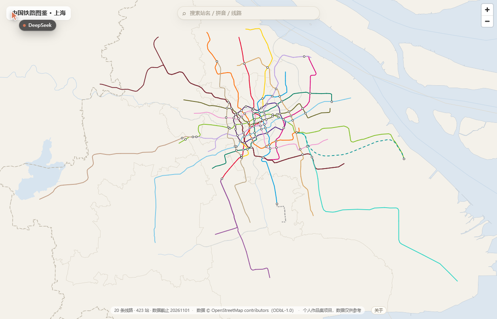

# 中国铁路图鉴 · 上海

把上海 20 条城市轨道交通线路按**真实地理走向**画在地图上，点车站看线路、站序与换乘。
数据来自 OpenStreetMap，全链路 WGS-84，底图自建，不依赖任何第三方瓦片。

**[→ 线上站点](https://yukkki305.github.io/subways/)** ｜ 个人作品集项目，数据仅供参考



## 这是什么

- **一张能查的地铁图**：20 条线路 / 423 座车站 / 570 个区间 / 12 条换乘关系，点击任意车站弹出线路、站序、换乘距离与数据来源
- **一套可重跑的数据管道**：省级 OSM PBF → 关系抽取 → 归一 → 建模 → 区间切分 → 归属校验 → 静态产物，一条命令重建
- **一份写下来的决策记录**：每个踩过的坑都落成 ADR（`docs/decisions/`），下面「四个硬问题」是其中的代表

**不做**：市域铁路/城际/高铁（数据结构预留）、示意化线路图、换乘路径规划、首末班车、实时到站。

## 规模

| 项 | 数值 |
| --- | --- |
| 线路 | 20（地铁 1–18 + 浦江线 + 磁浮线），23 个运营交路分支 |
| 车站 | 423（592 站次） |
| 区间 | 570 段，合计 946.18 km（按 branch 累加，含共线重复） |
| 换乘 | 12 条（同名多站之间）；`is_transfer` 站点 100 |
| 检索索引 | 443 条（423 站 + 20 线），中文 / 拼音全拼 / 首字母 / 英文 / 线路号 |
| 静态产物 | 4.08 MB（gzip ≈ 0.92 MB），首屏 17 个请求 |

## 四个硬问题，以及怎么解决的

作品集里真正值得看的是过程。这四个问题都不是「调个参数」，而是查证后改了方案：

| 问题 | 发现 | 结论 |
| --- | --- | --- |
| **坐标系** | GZUPA 2020 数据集里的 `x/y` 实测是 **GCJ-02**（与 OSM 差 405–510 m），其 `wgs84_*` 字段更是偏 700–930 m | 按「禁止纠偏后使用」的规则，GZUPA 只用于**站名比对**，不作几何来源；几何改走 OSM 自身快照（[ADR 0002](docs/decisions/0002-gzupa-datum.md)） |
| **取数通道** | Overpass 9 个端点全部不可达（6 个 TCP 000、1 个 504、1 个只有瑞士数据） | 主路径改为 `download.openstreetmap.fr` 的**省级 PBF** + pyosmium，实测上海 29.7 MB / 12 s（[AGENTS §15](AGENTS.md)） |
| **底图** | 跨境带宽 0.6–17 KB/s，139 GB 行星 PMTiles 抽上海子集不可行 | P0 改为**自建极简底图**：五省 PBF 里拼出上海市界、主水系与 24,829 km² 海域，0.47 MB + 0.09 MB（[S4-4 记录](web/README.md)） |
| **中文字体** | MapLibre 6.16 实测：`glyphs` 缺省时 PBF 请求 **0**、警告 **0**，中英文正常渲染 | **不建 glyph 管道**，中文由本机栅格化；500 站首次渲染 73–93 ms（[探测 7](AGENTS.md)） |

另外两处「数据说了算」的修正：

- **12 组同名多站**：`AGENTS` 原写「16 组」是探针口径（含站台节点），建站后实际 12 组 → 4 组合并为单站（静安寺/南京西路/徐家汇/宜山路）、8 组保留分裂走 `transfer`（[ADR 0003](docs/decisions/0003-split-group-merges.md)）
- **17 号线站名**：GZUPA 显示官方名是「诸光路」，OSM 标成「国家会展中心」→ 记入台账，P1 改名重跑（[conflicts](docs/conflicts.md)）

## 架构

```text
OSM 省级 PBF（五省，快照在仓库外）
        │  pyosmium
        ▼
pipeline/01 快照下载 → 02 关系抽取 → 03 底图要素 → 04 关系清单
       → 05 归属校验 → 08 线路建模 → 09 站点合并 → 10 区间切分
       → 11 换乘 → 12 属性 → 13 八项校验
        ▼
data/processed/  (lines / station / transfer / segment / basemap / sea)
        │  web/scripts/sync-data.mjs（sha256 幂等）
        ▼
web/  Next.js 16 静态导出 + MapLibre GL JS 6.16  →  out/  →  GitHub Pages
```

- 地图：MapLibre，21 个图层（海面 → 水系 → 行政界 → 线路描边 → 线 → 三种制式线型 → 站点光晕/圆点/选中 → 站名三档）
- 前端：Next.js App Router + `output: "export"`，无运行时数据请求（数据是静态文件）
- 部署：`npm run deploy` 一条命令（构建 → 临时 `gh-pages` 分支 → 推送；脚本自动写 `.nojekyll`）

## 本地运行

```powershell
# 前端（Node 26 + npm）
cd web
npm.cmd install --registry=https://registry.npmmirror.com
npm.cmd run dev          # http://localhost:3000/subways

# 数据管道（Python 3.14，venv 在仓库外）
$env:PYTHONUTF8 = '1'
E:\subway-data\venv\Scripts\python.exe pipeline\run_s1.py --from S1-3
```

校验：

```powershell
cd web
npm.cmd run typecheck    # 0 错
npm.cmd run test:search  # 22 条检索用例 + 性能断言
npm.cmd run build && npm.cmd run verify   # 21 项构建自证
```

## 目录

| 路径 | 内容 |
| --- | --- |
| `pipeline/` | Python 数据管道（13 个脚本 + `run_s1.py` 编排） |
| `data/processed/` | 进仓库的静态产物（线路 / 站点 / 换乘 / 区间 / 底图 / 海面） |
| `data/README.md` | 每个数据文件的**来源、许可、截止日期**三问表 |
| `web/` | Next.js 前端；`web/lib/search.ts` 是零依赖检索 |
| `docs/decisions/` | ADR：`0001` 建模规则、`0002` GZUPA 坐标系、`0003` 同名站定案 |
| `docs/validation-s*.md` | 每一阶段的验证记录（静态断言 + 浏览器实测 + 载荷） |
| `docs/acceptance-p0.md` | P0 九项验收签字表 |
| `AGENTS.md` | 本仓库的工作契约（范围、坐标系、数据来源、网络降级） |

## 数据与许可

- 数据 © OpenStreetMap contributors，**ODbL-1.0**；本仓库派生的数据文件沿用同一许可
- 站点属性另参考 GZUPA 2020 数据集（仅取站名、不用其坐标）与百度百科线路页（事实性字段）
- 官方线路图仅用于提取客观事实（站名/线路色/站序），图形资源不入库
- 代码 MIT

## 已知局限

1. 17 号线「国家会展中心」应为「诸光路」（OSM 错标），P1 改名重跑
2. 12 条换乘中 9 条的换乘类型（通道/出站）为人工判定，待核实
3. 数据为 2026-11-01 快照，非实时；每年新增约 50 条（段）线路需要增量更新
4. 底图为 P0 极简版（无道路、无 POI），只为让线路成为视觉主体
5. 目前只有上海一城；全国 58 城的 P1 需要各省站名来源与闭合省界

## English

A georeferenced map of Shanghai's 20 urban rail lines (423 stations, 570 segments), built from
OpenStreetMap province PBFs with a re-runnable Python pipeline and rendered with MapLibre GL JS.
Static export, no runtime data calls, no third-party basemap tiles. Portfolio project — data for
reference only.

---

路线图：**P0 单城打样 ✅**（验收表见 `docs/acceptance-p0.md`）→ **P1a 三城试点 🟡**（广州 / 成都 / 合肥；[计划与执行记录](docs/plan-p1a.md)、[探测报告](docs/probe/p1a.md)；管道多城化已完成，广州跑到换乘前）→ P1 全国 58 城 → P2 示意化 + 换乘规划 → P3 增量更新。
数据规模参考：截至 2024-12-31，全国 58 城 / 361–362 条运营线路 / 12,160.77 km。
